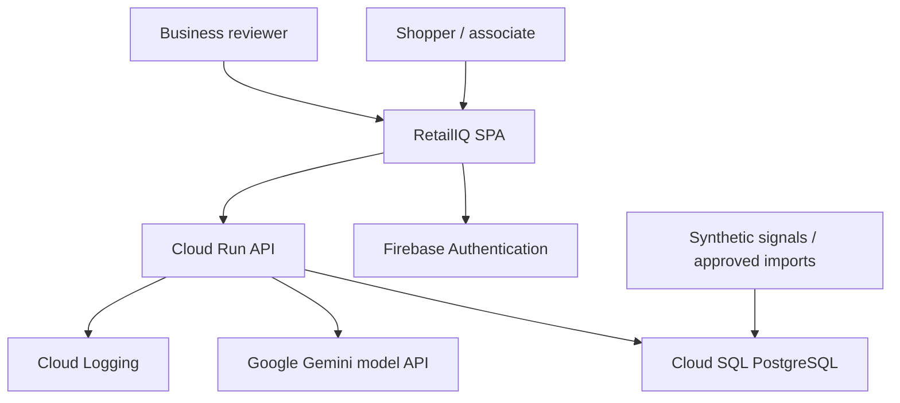
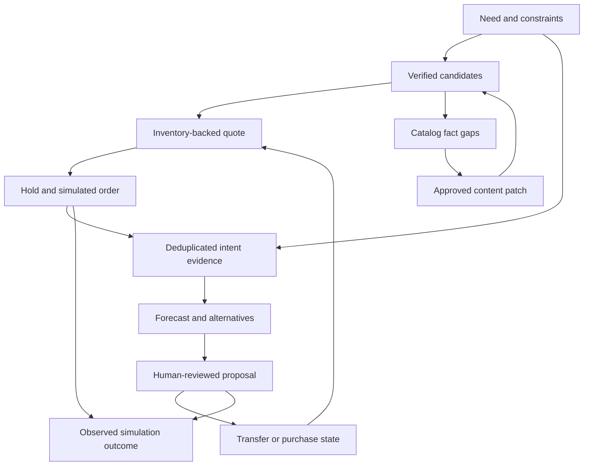

# System architecture

The repository to be created has `frontend/`, `backend/`, `infra/`, `tests/e2e/`, `evidence/`, and this `retailiq-spec/` directory. Copy the packaged AGENTS instructions to repository root, adjusting its links to `retailiq-spec/`. Application source is intentionally absent from this handoff.

## System context

The browser receives static assets from Firebase Hosting and calls the Cloud Run HTTPS URL directly. No Hosting-to-Run rewrite is required; this avoids region constraints on rewrites. Firebase only stores identity and static assets. All retail state lives in PostgreSQL.

## Component responsibilities

| Component/module | Owns | Must not own |
|---|---|---|
| `frontend/src/features/shop` | Intent chat, product comparisons, one-line cart, hold timer | Stock mathematics or business authorization |
| `frontend/src/features/associate` | Store filters, availability, operational transitions | Editing inventory balances directly |
| `frontend/src/features/business` | Forecasts, proposals, catalog patches, outcomes | Recalculating backend money or forecasts |
| `backend/app/api` | Typed HTTP schemas, auth, request IDs, error translation | Embedded SQL or LLM prompts |
| `services/catalog` | Verified facts, lexical search, attribute filters, audit | Fetching arbitrary user URLs |
| `services/inventory` | ATP, allocations, locks, stock ledger | Calling Gemini inside a transaction |
| `services/fulfillment` | Eligible routes, deadlines, quote snapshots | Inventing delivery promises |
| `services/commerce` | Hold conversion, orders, returns and simulation events | Real payment/courier APIs |
| `services/planning` | Backtests, forecasts, signals, scenario simulation, recommendations | Model-generated quantities |
| `services/ai` | SDK adapter, input extraction, bounded tools, fact-linked explanations | Model-generated quantities |
| `services/audit` | Actor/action/snapshot event log | Raw tokens or full personal conversations |

Use regular Python service functions and typed DTOs, not independent “agent” processes. Route handlers can be synchronous (`def`) for synchronous SQLAlchemy; async SDK calls run in a clearly separated orchestration layer. Never block the event loop with synchronous DB operations; use FastAPI's threadpool path for those handlers. One DB session per request, explicit commit boundaries.

## Connected data flow

Each event carries `workspace_id`, `trace_id`, optional `intent_id`, `sku_id`, `location_id`, and server timestamp. The planning refresh stores source event IDs and the inventory version snapshot. This is the join that makes the loop inspectable.

## Trust boundaries

1. Browser is untrusted. Verify Firebase token signature, issuer, audience, expiration; derive UID server-side. Resolve workspace membership from DB. Customer role only owns its own orders/holds. In public demo every user is manager of an isolated synthetic workspace.
2. Model output is untrusted. Validate schemas, enum values, allowed SKU IDs and fact references. No model tools execute SQL, HTTP, shell commands, purchases, transfers or patch publication.
3. Database is authoritative. Composite tenant foreign keys prevent cross-workspace references. Repositories require a workspace context; tenant-filter omission is covered by tests.
4. Provider data and catalog text are content, never instructions. Do not execute links or instructions embedded in a product description.
5. Cloud service identity has runtime privileges only. Migration job uses a separate DB owner and service account. No persistent service account keys.

## Transaction boundaries and concurrency

Read-only recommendations can use a repeatable-read snapshot. Inventory-changing operations use short read-committed transactions with `SELECT FOR UPDATE` on every affected inventory row in sorted `(workspace_id, sku_id, location_id)` order. Lock parent order/transfer/recommendation first using one documented service ordering; no path locks the same entity classes in reverse order. Stock decreases also write movement and allocation state in the same commit.

Idempotency is stored in PostgreSQL with a unique operation key. A transaction-scoped advisory lock on its hashed workspace/UID/key serializes duplicate requests. Exact algorithm and replay semantics are in [04_API_AND_INTEGRATION_CONTRACTS.md](04_API_AND_INTEGRATION_CONTRACTS.md). Do not use in-memory locks across Cloud Run instances.

Planning refresh locks the workspace planning advisory key, snapshots evidence, computes outside inventory locks, then stores one immutable run and its proposals atomically. Approving a proposal rechecks every relevant stock/catalog/policy version and recalculates; stale proposals get a 409 and a replacement must be reviewed.

## Failure handling

| Failure | Response | Recovery |
|---|---|---|
| Gemini timeout/quota/schema error | Grounded search still works; `ai_mode=fallback`; no fabricated explanation | Explicit keyword/constraint controls; retry bounded in [05_AI_AND_AGENT_DESIGN.md](05_AI_AND_AGENT_DESIGN.md) |
| PostgreSQL unavailable | Readiness 503; APIs 503 `DEPENDENCY_UNAVAILABLE`; no client-side order success | Retry reads with jitter; user retry for writes with same key |
| Stock consumed after quote | 409 `INSUFFICIENT_STOCK` or `QUOTE_STALE` | Refetch availability and create new quote |
| Expired hold | 409 `HOLD_EXPIRED` | Explain expiry; new quote/hold |
| Expired auth | 401 once, client refreshes ID token | Retry once; otherwise reauthenticate |
| Missing external source | Synthetic source remains visibly labelled | Disable live connector, not core planning |
| Audit explanation fails | Numeric proposal still shown with deterministic explanation template | Human sees sources and assumptions |
| Refresh fails | Keep prior completed run marked stale | Retry; no half-written run becomes current |

## Deployment and operational limits

Cloud Run: 1 vCPU, 512 MiB, concurrency 10, max instances 3, min instances 0, timeout 60 seconds, one Uvicorn worker. DB pool size 3, overflow 2 per instance: at most 15 application connections plus migration/admin connections. Live AI budget is 20 seconds; planning target under 10 seconds on 24 SKUs. These are performance acceptance targets, not measured results.

Cloud SQL: PostgreSQL 17, Enterprise edition, single-zone `db-custom-1-3840`, 10 GiB SSD initially, automatic storage growth capped at 20 GiB, deletion protection and backups. Public IP with no authorized public networks; connect via Cloud Run Cloud SQL socket integration. Do not expose port 5432 publicly. No dedicated VPC is necessary for this demo. Production can migrate to private IP without changing repositories or business contracts.

Health: `/health/live` checks process only; `/health/ready` runs a short DB query and checks expected Alembic head; it does not call the model. Authenticated `/api/v1/system/status` reports dependency configuration and last successful model probe without secret values.

No in-process scheduler or fire-and-forget background task is responsible for durable mutations. Hold expiry is evaluated on every ATP query and write. Manager refresh is synchronous. A documented Cloud Run maintenance job can expire allocations and remove demo workspaces older than 24 hours. Expired rows do not reserve stock even before cleanup runs.

## Observability

Structured JSON logs: severity, request_id, trace_id, hashed actor_uid, workspace_id, route, status, duration_ms, model_id, prompt_version, token counts, run_id and stable error code. Exclude credentials, raw auth headers, full prompts, customer names and free text. Record model latency and fallback reason; keep factual tool trace for the owner workspace with prices/quantities from actual tool results. Audit logs record action references and hashes of snapshots. Retain operational logs 7 days for this demo; retain synthetic business state until reset/expiry. No production customer data is authorized.
